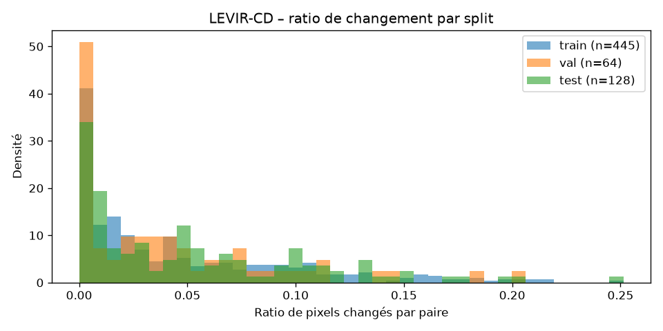

# LEVIR-CD – rapport qualité et EDA

Généré par `python -m pixelmind.data.eda` à partir du manifeste (`data/manifests/levircd.jsonl`).

Total : **637 paires**.

## Par split

| Split | Paires | PASS | WARN | REVIEW | FAIL | Tailles | Paires sans changement | Ratio moyen | Médiane | P95 | Max | Part pixels positifs |
|---|---|---|---|---|---|---|---|---|---|---|---|---|
| train | 445 | 421 | 24 | 0 | 0 | 1024x1024 (445) | 47 (11%) | 4.59% | 2.60% | 15.82% | 24.83% | 4.59% |
| val | 64 | 61 | 3 | 0 | 0 | 1024x1024 (64) | 8 (12%) | 4.20% | 3.10% | 13.73% | 20.38% | 4.20% |
| test | 128 | 123 | 5 | 0 | 0 | 1024x1024 (128) | 10 (8%) | 5.09% | 3.73% | 14.75% | 25.13% | 5.09% |

## Anomalies qualité

| Statut | Code | Occurrences |
|---|---|---|
| WARN | `mask_near_binary` | 32 |

## Distribution du ratio de pixels changés

