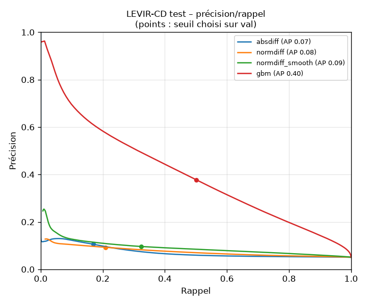

# Benchmark LEVIR-CD

Généré par `python -m pixelmind.experiments.report`. Protocole commun (`pixelmind.evaluation.protocol`) : seuil choisi sur **val** (F1 max), métriques sur **test** (128 paires) au niveau pixel, micro-moyennées sur toutes les images. F1 = Dice au niveau pixel.

Manifeste `data/manifests/levircd.jsonl` (sha256 `90c835db7aef…`).

## Résultats (test)

| Modèle | Seuil | F1 val | Précision | Rappel | **F1** | IoU | PR-AUC (AP) | FPR | Éval. |
|---|---|---|---|---|---|---|---|---|---|
| `absdiff` | 104 | 12.9% | 10.6% | 16.9% | **13.0%** | 7.0% | 7.3% | 0.077 | 18 s |
| `normdiff` | 115 | 11.9% | 9.3% | 20.9% | **12.8%** | 6.9% | 7.5% | 0.110 | 47 s |
| `normdiff_smooth` | 82 | 13.3% | 9.6% | 32.4% | **14.8%** | 8.0% | 9.2% | 0.163 | 50 s |
| `gbm` | 200 | 41.8% | 37.8% | 50.0% | **43.1%** | 27.4% | 40.0% | 0.044 | 1432 s |

## Analyse d'erreurs (test)

F1 par quantité de changement dans la scène (pixels changés / total) :

| Modèle | no change | < 1 % | 1-5 % | > 5 % | F1 médian par scène |
|---|---|---|---|---|---|
| `absdiff` | FPR 1.2% | 2.6% | 9.3% | 15.7% | 5.8% |
| `normdiff` | FPR 9.4% | 2.4% | 11.7% | 16.6% | 10.1% |
| `normdiff_smooth` | FPR 13.7% | 2.7% | 13.2% | 19.6% | 12.6% |
| `gbm` | FPR 1.7% | 12.5% | 36.4% | 48.5% | 37.0% |

Scènes par groupe : no change = 10, < 1 % = 27, 1-5 % = 38, > 5 % = 53

### 10 pires scènes – `gbm`

| Scène | Changement | F1 | Précision | Rappel |
|---|---|---|---|---|
| levircd_test_test_63 | 0.0% | 0.1% | 0.1% | 5.3% |
| levircd_test_test_59 | 0.0% | 0.2% | 0.1% | 40.0% |
| levircd_test_test_88 | 0.1% | 0.4% | 0.2% | 10.8% |
| levircd_test_test_61 | 0.0% | 0.5% | 0.3% | 9.7% |
| levircd_test_test_99 | 0.0% | 0.6% | 0.3% | 37.5% |
| levircd_test_test_95 | 0.0% | 0.9% | 0.5% | 65.6% |
| levircd_test_test_98 | 0.0% | 1.2% | 0.6% | 43.0% |
| levircd_test_test_94 | 0.1% | 1.2% | 0.6% | 93.9% |
| levircd_test_test_128 | 0.1% | 1.8% | 0.9% | 29.9% |
| levircd_test_test_58 | 0.1% | 3.4% | 1.7% | 62.5% |

## Baseline 1 – features + gradient boosting

835,317 pixels d'entraînement échantillonnés (équilibrés, part positive 47%), 200 itérations, 396 s d'entraînement.

Importance par permutation (baisse de F1 sur un échantillon val) :

| Feature | Δ F1 |
|---|---|
| `t2_b` | 0.177 |
| `t2_r` | 0.128 |
| `zdiff_local_mean_15` | 0.106 |
| `t2_g` | 0.103 |
| `t1_b` | 0.060 |
| `t1_r` | 0.054 |
| `zdiff_local_std_15` | 0.043 |
| `grad_t2` | 0.020 |
| `t2_minus_t1_gray` | 0.010 |
| `t1_g` | 0.009 |

## Reproductibilité

| Modèle | Commit | Seed | Machine | Détails |
|---|---|---|---|---|
| `absdiff` | `006faa65-dirty` | 42 | x86_64, CPU only |  |
| `normdiff` | `006faa65-dirty` | 42 | x86_64, CPU only |  |
| `normdiff_smooth` | `006faa65-dirty` | 42 | x86_64, CPU only |  |
| `gbm` | `006faa65-dirty` | 42 | x86_64, CPU only |  |
